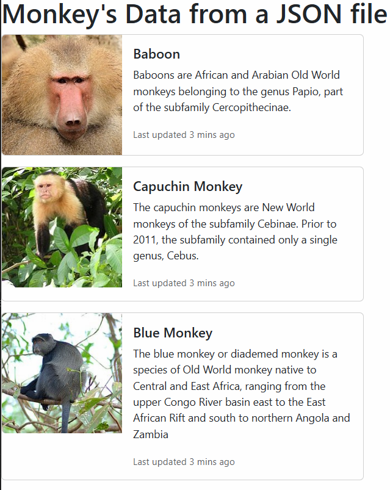

# Assignment Instructions & Active Participation

The assignments for this course are available in the course GitHub repository:

## Active Participation — 10% of Your Final Grade

These assignments are part of your **Active Participation**, which contributes **10% toward your total course grade**.

Active participation is demonstrated by regularly engaging with the daily lessons, attempting the assigned exercises, completing the related work, and keeping your submissions up to date.

The expectation is **consistent participation throughout the course**, rather than completing all assignments at once near the end.

## How Assignments Will Work

The assignment list contains exercises that will be completed **gradually as the course progresses**.

**You are NOT expected to complete all assignments at once.**

Assignments are connected to the topics covered during our daily lectures. As we learn a topic, the related assignment(s) may be:

* completed together during class,
* started during class and completed afterward, or
* assigned at the end of the daily lesson for you to complete independently.

## What You Are Expected to Do

Follow the course **one topic at a time**.

When a topic has been taught and its assignment has been discussed or assigned, you are expected to attempt and complete the related assignment.

You may attempt **all or any number of the assignments that have been covered or assigned so far**, but you are strongly encouraged to stay up to date. Regular completion and submission of these activities forms part of your **Active Participation assessment**.

Do **not** feel that you need to complete the entire GitHub assignment list immediately. Some assignments depend on concepts that will be introduced in upcoming lectures.

## Submission Through D2L

Assignments will be submitted through **D2L**.

The expected workflow is:

**Learn the topic → Practice in class → Complete the related assignment → Submit it to D2L**

Assignments should be submitted as **individual files/submissions as instructed**.

When an assignment is completed in class or assigned during/end of a daily lecture, you should complete the work and have it **ready for submission through D2L**.

Do not wait until the end of the course to complete and submit all assignments together. The purpose of these activities is to demonstrate your **ongoing participation and progress throughout the course**.

## Important

The GitHub `Assignments.md` page is the **assignment reference for the course**, but seeing an assignment listed there does **not automatically mean that it is currently due**.

Your instructor will indicate during the daily lectures which topics and assignments you should currently be working on.

### Simple Rule to Follow

> **If we have covered the topic and the assignment has been discussed or assigned, complete it and be ready to submit it through D2L. If we have not covered the topic yet, you are not expected to complete that assignment yet.**

### Remember

**These assignments are part of Active Participation and contribute toward 10% of your total course grade.**

The goal is to **learn, practice, complete, and submit consistently as the course progresses** — not to rush through the entire assignment list at once.

### Assignment # 1
Explain different types of computer languages. 

### Assignment # 2
Explain Difference between interpreted  vs complied language.

### Assignment # 3
Declaration vs Assignment vs Initialization

### Assignment # 4
Create a HTML page link the script.js file 
Change the text in a paragraph at the load and also using a button.
Bring the date and time on the page when user Clicks the button.

### Assignment # 5
Tip Calculator 

### Assignment # 6
Weight Calculator 

### Assignment # 7
Age Calculator 

### Assignment # 8
Temp Calculator 

### Assignment # 9
Loan Calculator 

### Assignment # 10
Refactor the four_function_calculator.html in day-07 folder to use the switch statement [switch](https://www.w3schools.com/js/js_switch.asp).

### Assignment # 11
Refactor BankAccount [Version 0](https://github.com/msadeedashraf/javascript-102024-am/tree/main/day12/BankAccount) 

 

to Version 1 

 

to Version 2 

### Assignment # 12
Creating Analog Clock. [Clock](https://www.youtube.com/watch?v=Ki0XXrlKlHY&t=2s&ab_channel=WebDevSimplified)

### Assignment # 13
Creating a calculator. [calculator](https://www.youtube.com/watch?v=j59qQ7YWLxw&t=2s&pp=ygUxY3JlYXRlIGEgY2FsY3VsYXRvciB1c2luZyBodG1sIGNzcyBhbmQgamF2YXNjcmlwdA%3D%3D)

### Assignment # 14
- Connect to the Monkey Data 
- Use Day-16 jobzila/joblisting page as an example
- https://raw.githubusercontent.com/jamesmontemagno/app-monkeys/master/MonkeysApp/monkeydata.json

### Assignment # 15
Random Meal Generator [link](/day19/random_recipe_assignment/)

### Assignment # 16
Refactor the Day-17/random-recipe-v2 to get rid of the empty ingredients list.
